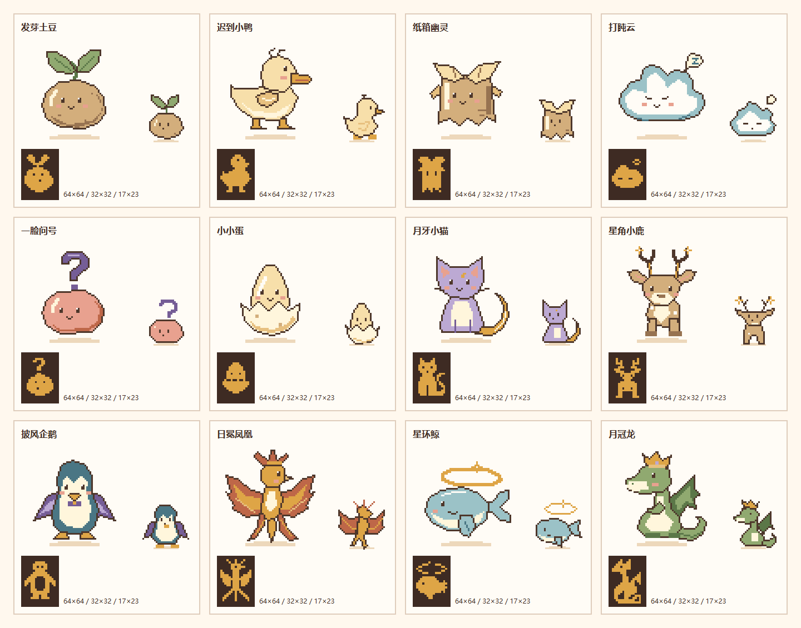

# 破壳倒计时

一款温暖像素风的宠物陪伴计时器，为 STEPX Neo 的双屏体验设计。设置倒计时时长，把手机正面朝下，陪一颗蛋慢慢孵化。正面是复古像素小屋，背面的 17×23 点阵屏呈现等待、裂纹与破壳；到期用两次短振提醒，回到主屏认识新伙伴。倒计时时长决定本局宠物等级。

[首页预览](docs/previews/start-390.png) · [收藏预览](docs/previews/collection-390.png) · [最终验收](docs/final-acceptance.md) · [开发交接](docs/handover.md)



预览图使用隔离测试存档，不包含真实用户记录。主屏、缩略图和背屏分别绘制，共享角色身份。

## 功能

- **三个页面**：开始页、孵化及揭晓页、收藏页。音效默认关闭，进度与收藏只保存在本机，无业务后端、登录或支付。
- **自定义分秒计时**：分钟和秒分别输入，总时长为 1 秒至 180 分钟，默认 3 分钟；记住最近有效时长。首页即时显示可孵出的等级，并使用一个开始按钮，不再提供时长快捷选项或“体验一局”。
- **四档、12 只独立宠物**：按开局时长确定等级，再从该档 3 只宠物中等概率抽取。宠物和等级在开局时锁定，延迟揭晓、刷新或保存重试不改变结果。
- **互动收藏**：四档展示已遇见 x / 12、次数与最近日期；已拥有角色可打开详情，轻点打招呼、按住 600ms 陪伴。12 只角色各有专属动作，卡片缩略图静止；互动不改变计时、抽取、收藏或选择，不增加养成数值。
- **柔和音效与到期振动**：12 只宠物拥有不同短旋律，轻点活泼、长按低柔；蛋、开局、裂纹、到期和破壳各有提示音。首页开启音效时播放试听并记住开关；关闭或进入后台立即停止声音，不播放背景音乐或逐秒滴答。到期无论音效是否开启都调用原有 Capsule 短振，前台两次间隔 250ms，每局提醒一次；离开前台、结束或揭晓取消尾振，不补振。
- **整体像素界面**：64×64 主角色、独立 32×32 缩略图、同轮廓分割的标准蛋与像素小窝；面板、输入、弹层和异常提示统一设计。像素标题与数字字体本地打包，正文保持清晰中文字体；首页不显示四档规则列表。
- **正背屏分工**：背屏用独立绘制的精简点阵表现阶段与回应；孵化仍在进度 50%、85% 和到期切换。揭晓先播放 1200ms 破壳，再显示名字、短句与伙伴；减少动态时直接相遇，重载已揭晓结果不重播。
- **间歇陪伴**：自主动作按 8／10／12 秒开始间隔轮换，触摸只联动当前蛋或已保存的背屏伙伴；阶段与目标变化优先于手动回应，手动回应优先于待机。背屏始终串行，上一帧回执后至少停留一秒，失败后需显式重试。
- **背屏伙伴**：新孵出的宠物自动成为当前选择，之后可从收藏更换或停止展示。未揭晓的蛋优先，包含到期待揭晓期间；主动结束后恢复此前选择。返回旧结果页不会覆盖后来选择的伙伴。
- **已有局保护**：编辑时长不改变当前一局，重新开始需要确认；揭晓保存失败可重试，不重复计数。
- **存档读取保护**：读取失败、记录损坏或未知版本时保留原数据，显示“重新读取”；读取成功前不开放新局与保存操作，不将旧收藏当成空记录覆盖。

## 时长与宠物

按输入的精确秒数判定，不把时长四舍五入为整分钟：

| 等级 | 时长范围 | 宠物 |
| --- | --- | --- |
| 低级 | 00:01–02:59 | 小小蛋、发芽土豆、一脸问号 |
| 普通 | 03:00–06:59 | 迟到小鸭、纸箱幽灵、打盹云 |
| 高级 | 07:00–09:59 | 月牙小猫、星角小鹿、披风企鹅 |
| 华丽 | 10:00–180:00 | 日冕凤凰、星环鲸、月冠龙 |

分钟允许 0–180，秒允许 0–59；总时长必须在 00:01–180:00 内。空值、非整数、负数、00:00、180:01 等无效输入会阻止开始并提示原因。

## 旧数据兼容

本地记录内容升级为 v2，继续使用原来的存储键 `egg.record.v1`。旧 6 只宠物的 ID、收藏次数和最近日期保留，收藏按新目录分组；分组不代表历史收藏曾按新时长规则获得。

更新前已开始的一局保留原宠物、计时和进度，等级记为空，孵化及揭晓页不展示推断等级。旧演示局仍可完成，但不能新建演示局。旧局完成后“再孵一颗”使用最近有效的正常时长，缺失或无效时默认 3 分钟；新版局再次孵化沿用该局时长。

背屏选择保存在同一记录的 `settings.backScreenPetId`；旧 v2 记录缺失该字段、角色无效或未拥有时归为 `null`，下次正常保存时带入。收藏计数与日期不受选择或停止展示影响。

## 平台能力

- **背面点阵屏（连接器 ic_atomic_990001）**：通过 `window.mcp.callTool` 提交 `set_back_screen_frame`（391 个亮度值，17 列 × 23 行、行优先），以 `clear_back_screen_frame` 释放，`wake_up_back_screen` / `sleep_back_screen` 控制亮灭。接入层位于 `src/shared/egg/backScreen.ts`，本轮沿用原架构。
- **壳能力**：经现有桥接调用 `getSensor`、`vibrateShort`、`setKeepScreenOn`、`setStorage` / `getStorage`、`privacy.getStatus`、`appShow` / `appHide`。翻面自动揭晓仍是默认关闭的实验开关；到期未揭晓最多保持亮屏 30 秒后释放。
- **验证边界**：浏览器背屏为显著标识的模拟桥；动画命令统一串行调度，隐藏时暂停、返回时恢复当前状态。宠物展示不额外保持正面常亮，不承诺锁屏后台动画；真实显示、传感器、振动与后台恢复需要在 APK 真机上验证。

## 运行

需要 Node.js ≥20.19（本轮使用24.17）、npm，以及可运行 `keytool` 的 JDK。浏览器预览无需 JDK；完整客户端构建会在缺少签名文件时生成本地调试证书，需要 JDK 的 `bin` 在 PATH，或设置 `JAVA_HOME`／`KEYTOOL`。调试签名不用于正式发布，私钥和 `.env.local` 不进入 Git。

新仓库为 `aladyaraya/pixel-pet-nest`（私有），使用已获访问权限的账号克隆：

```bash
gh repo clone aladyaraya/pixel-pet-nest
cd pixel-pet-nest
```

```bash
npm ci                                       # 按锁定版本安装依赖
node node_modules/playwright/cli.js install chromium # 首次网页验收前安装浏览器
npm run dev -- --host 127.0.0.1 --port 5179 --strictPort # 保持终端在线
npm run typecheck                            # 类型检查
node --test src/shared/egg/backScreenScheduler.test.mjs # 背屏调度器独立测试
npm run build                                # 壳侧主产物为 dist/client/
npm run test:e2e -- http://127.0.0.1:5179/     # 在另一终端运行，地址须匹配预览服务
npm run test:pixel -- http://127.0.0.1:5179/   # 像素、真实触摸模拟与双屏联动验收
npm run test:feedback -- http://127.0.0.1:5179/ # 音效与到期振动验收
npm run test:recovery -- http://127.0.0.1:5179/ # 读档保护与后台翻面回归
```

打开 `http://127.0.0.1:5179/`。如果链接拒绝连接，先检查运行 `npm run dev` 的终端是否仍在运行；服务退出后重新执行上述启动命令即可。端口占用时先确认是不是已有预览服务，不要直接结束其他进程。

网页验收默认访问 5173 端口，本机实际服务位于 5179。像素版本的结果、截图、动作录屏及复现命令见 [像素伙伴验收](docs/pixel-pets-acceptance.md)，证据另存 `.acceptance-pixel/`。先前绘本、背屏专项和分秒计时的报告均保留为历史。构建产物仍需要由平台打包为 APK；网页通过不等于真机验证。

音效与振动补充验收见 [反馈验收](docs/feedback-acceptance.md)，证据另存 `.acceptance-feedback/`。声音需要当前页面已有用户手势解锁；恢复页面不补播过去提示音。后台／锁屏能否按时振动由设备运行能力决定，网页验证不保证系统挂起时唤醒应用。

## 交接

背屏参考文件的协议对照、调用追踪、异常修复及真机边界见 [背屏接口核验](docs/back-screen-verification.md)。可用 `npm run test:back-screen` 重跑适配器与调度器测试；本地回执通过不能代替真机显示验证。

二次开发先读 `docs/handover.md`。本轮已确认的需求与实现落点、数据兼容规则记录在该文档中；原始 `docs/这颗蛋快孵出来了-PRD.docx` 保留为 V0.1 历史需求，不改写原件。新旧需求有差异时，以本轮确认的规则为准。

本次新仓库交付的测试结果、最终修复与待做事项见 [最终验收](docs/final-acceptance.md)。运行入口、设备契约、签名与接手顺序见 [交接文档](docs/handover.md)。旧版 `egg-handover.bundle` 历史包已从当前仓库移除，可在历史提交中查看；它不是 APK，当前源码以本仓库 `main` 分支为准。
